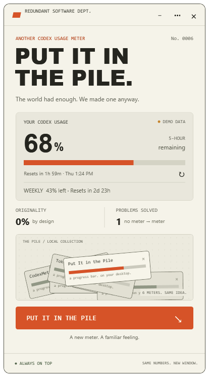

# PUT IT IN THE PILE

**The world had enough. We made one anyway.**

A small, always-on-top Codex usage meter for Windows. Yes, another one.

[**Download the latest Windows release**](https://github.com/Phr3dTheRipper/put-it-in-the-pile/releases/latest) · [Build checks](https://github.com/Phr3dTheRipper/put-it-in-the-pile/actions/workflows/build.yml) · [MIT license](LICENSE)



## A solution to a solved problem

After seeing several thousand usage meters, we identified a gap in the market: none of them were this one.

- **Actual usage.** Your Codex quota and reset times, now in our rectangle.
- **Always on top.** Reflecting the importance of this contribution.
- **PUT IT IN THE PILE.** Each click drops another miniature usage meter onto your growing local pile.
- **0% originality.** Rigorously maintained by design.
- **Compact mode.** The same breakthrough, in less space.
- **Launch-post generator.** Copy an earnest announcement of this historic achievement.

No waitlist. No monetization strategy. No reason.

## Download and run

1. Open [Releases](https://github.com/Phr3dTheRipper/put-it-in-the-pile/releases/latest).
2. Download `PutItInThePile-Windows.zip` under **Assets**. The automatically generated “Source code” downloads do not include a compiled app.
3. Extract the ZIP into a writable folder and double-click `PutItInThePile.exe`.

**Requirements:** Windows 10/11 with .NET Framework 4.8. Live data requires `codex.exe` and an existing ChatGPT-backed Codex sign-in. You can use the three-dot menu's **demo mode** without signing in.

The executable is currently **unsigned**. Windows may show an unknown-publisher or reputation warning. Verify the download source and the release's SHA-256 checksum before deciding whether to run it; some managed Windows configurations may block unsigned apps. See [Microsoft's explanation of SmartScreen reputation](https://learn.microsoft.com/en-us/windows/apps/package-and-deploy/smartscreen-reputation).

## Controls

| Control | Historic achievement |
| --- | --- |
| Drag the header | Move the window |
| Bottom-left status | Toggle always on top |
| **Esc** | Switch between full and compact views |
| **Ctrl+R** or ↻ | Refresh usage |
| **Ctrl+D** | Switch between live and labeled demo data |
| **PUT IT IN THE PILE** or compact ↘ | Add another meter to your local pile |
| **•••** | Demo mode, launch-post copy, compact mode, and help |
| **×** | Exit the app |

## Real numbers, fictional importance

Live mode starts a short-lived local `codex app-server` process, initializes it, reads [`account/rateLimits/read`](https://learn.chatgpt.com/docs/app-server), and closes the process. It refreshes every 60 seconds. The Codex service uses your existing sign-in to retrieve account limits from OpenAI.

- This app does not read or copy authentication tokens.
- It creates no chats, sends no inference requests, and posts nothing to Reddit.
- It stores no usage history, account details, or credentials.
- It displays the quota windows returned by your account. Weekly-only accounts show a weekly window; no extra quota is invented.
- Missing data displays **UNAVAILABLE**. Failed refreshes retain the previous value with a **STALE** label.
- Demo percentages are fictional and labeled. Pile count measures your local clicks. Originality and problems-solved counters are satire.

`pile-state.json`, beside the executable, remembers your pile count, window position, compact mode, and pin preference. Keep the extracted folder writable. Close the app and remove that file to start fresh.

### Codex not found?

Install/sign in to Codex, then refresh. The app looks for `codex.exe` on `PATH` and in the Windows Codex app's local bin directory. If you have another executable location, set `PILE_CODEX_PATH` to the full path of `codex.exe` before launching the widget.

## Build it yourself

The app uses C# and native WPF, with no third-party packages. Build on Windows with .NET Framework 4.8 installed:

```powershell
.\Build.ps1
.\scripts\Test.ps1
.\scripts\Package.ps1
```

`Build.ps1` uses the Windows .NET Framework compiler and produces `PutItInThePile.exe`. `Test.ps1` runs six quota-parser checks without needing a Codex account. `Package.ps1` creates the portable ZIP and checksum in `dist/`.

Other commands:

```powershell
.\PutItInThePile.exe --demo
.\PutItInThePile.exe --self-test parser-results.txt
.\PutItInThePile.exe --check-data usage-check.json
.\PutItInThePile.exe --preview preview.png
.\PutItInThePile.exe --demo --state alternate-pile-state.json
```

The three diagnostic commands write their output and exit. `--check-data` writes current quota percentages to the file you name. `--preview` renders labeled demo data without saving settings.

## Releases and contributions

GitHub Actions builds, tests, and packages pushes and pull requests. A pushed `v*` tag runs the same checks and publishes the ZIP and SHA-256 checksum as a GitHub Release.

Issues and pull requests are welcome. Please keep real usage data accurate and the app's credentials local. Unnecessary features should at least be funny.

See [the changelog](CHANGELOG.md), [release instructions](docs/RELEASING.md), and [the launch post](docs/launch-post.txt).

Unofficial parody. Not affiliated with OpenAI or the Codex subreddit. MIT licensed.

Same numbers. New window.
